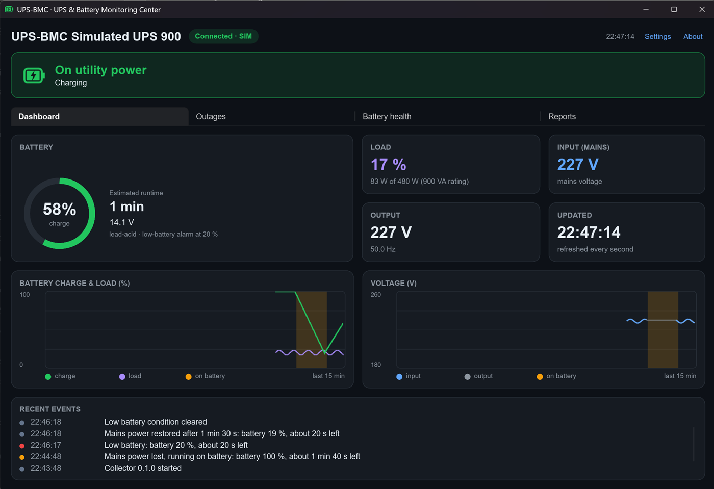
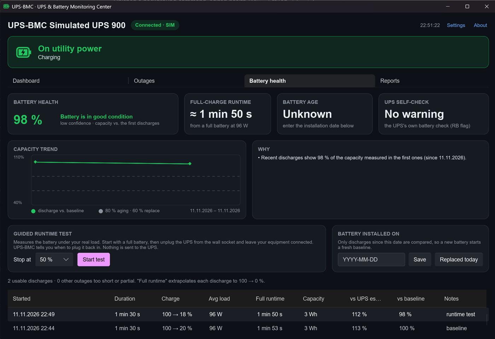

# UPS-BMC — UPS & Battery Monitoring Center

[](https://github.com/Alexxfromgit/UPS-BMC/actions/workflows/ci.yml)
[](https://github.com/Alexxfromgit/UPS-BMC/releases/latest)
[](LICENSE)

Monitoring, outage analysis and battery-health estimation for home UPS units on Windows, built in
Rust and Slint. It reads a USB UPS through Windows' own HID driver, so nothing has to be installed
or replaced, and Windows keeps its built-in UPS shutdown protection.

<p align="center">
  
  
</p>

- **Live dashboard:** charge, runtime, load, input/output and battery voltage every second, with
  charts, an event log, a tray icon and Windows notifications for power loss, low battery and
  restore.
- **Outages:** every outage with duration, battery used, energy and recharge time; statistics for
  today, 7 and 30 days and the month; monthly HTML and CSV reports.
- **Battery health:** an estimate of how much capacity the battery has lost, from its own
  discharges, with a guided runtime test ([ADR-0004](docs/adr/0004-battery-health-estimation.md)).
- **Small loads:** many UPSes read 0 % for a router or a laptop charger; you can enter an estimate
  instead.
- **Raspberry Pi:** run the collector next to NUT on an always-on Pi, watch it from the desktop UI
  over the LAN, and get notified through ntfy, Telegram or email
  ([guide](docs/raspberry-pi.md), [ADR-0005](docs/adr/0005-remote-collector-and-nut.md)).

> **Read-only by design.** UPS-BMC sends nothing to the UPS except the settings
> you change on purpose in **Settings**. Today that is only the beeper
> ([ADR-0001](docs/adr/0001-data-source.md), [ADR-0003](docs/adr/0003-ups-configuration-writes.md)). Shutdown protection is handled by
> Windows Power Options (or by NUT on the Pi), not by this app.

## Download

Get the latest version from [Releases](https://github.com/Alexxfromgit/UPS-BMC/releases/latest):

| File | What it is |
|---|---|
| `UPS-BMC-setup-<version>.exe` | Per-user installer for Windows 10/11 (x64); no administrator rights needed |
| `UPS-BMC-<version>-win-x64-portable.zip` | The same programs without installing |
| `UPS-BMC-<version>-linux-arm64-collector.tar.gz` | The collector for a Raspberry Pi (64-bit Raspberry Pi OS) reading NUT, with its systemd unit; see the [Raspberry Pi guide](docs/raspberry-pi.md) |
| `SHA256SUMS.txt` | Checksums of the files |

The installer is not code-signed yet, so Windows SmartScreen may warn about it (*More info* →
*Run anyway*). Every download has a signed build provenance; check it with
`gh attestation verify <file> -R Alexxfromgit/UPS-BMC`.

## Supported UPS models

UPS-BMC works with UPSes that connect over USB as a standard **HID Power Device**, which is how most
small UPSes from Eaton, APC, CyberPower and others appear to Windows (as a battery under
Power Options). It is developed and tested with the **Eaton 5E Gen2 900VA USB (5E900UD)**; other
models should work for monitoring. If yours doesn't, or shows odd values, please open an issue with
a [`hid-probe`](#probing-a-ups) capture. The beeper setting is only offered where it can be changed
safely.

## Before you start: enable shutdown protection
Control Panel → Power Options → Change plan settings → Change advanced power
settings → Battery:
- **Critical battery action:** Shut down (or Hibernate)
- **Critical battery level:** 20–30 %

This protects the PC whether or not UPS-BMC is running.

> **Don't install Eaton UPS Companion alongside UPS-BMC.** It swaps the UPS's
> Windows HID driver for its own libusb driver, and that driver stays behind
> after you uninstall Companion. See ADR-0001 for how to remove it.

## Roadmap
| Milestone | Scope | Status |
|-----------|-------|--------|
| M0 | Workspace, CI, ADRs, `hid-probe`, real-device capture | done |
| M1 = V1 | Collector + SQLite + API, Slint dashboard, tray, toasts | done (incl. beeper setting, autostart, installer) |
| M2 = V2 | Outage engine, outage history, statistics, monthly report (HTML/CSV) | done |
| M3 = V3 | Load-normalised battery degradation estimate, guided runtime test ([ADR-0004](docs/adr/0004-battery-health-estimation.md)) | done |
| M4 = V4 | NUT source, remote collector on a Raspberry Pi (systemd, arm64 build), remote UI with API token, ntfy/Telegram/email ([ADR-0005](docs/adr/0005-remote-collector-and-nut.md), [guide](docs/raspberry-pi.md)) | done |
| M5 | More UPS settings: output voltage, thresholds (beeper already done in M1) ([ADR-0003](docs/adr/0003-ups-configuration-writes.md)) | proposed |

**Polling:** each feature report takes about 44 ms on the 5E (USB control
transfer plus UPS firmware). The collector reads the 5 live reports (status,
charge/runtime, load/battery voltage, input/output, boost/buck) every
**1 s**, which takes about 220 ms. Static reports (ratings, strings,
configuration) are read every 60 s.

## Installing
Run the installer from [Releases](https://github.com/Alexxfromgit/UPS-BMC/releases/latest), or
build it yourself:
```bash
.\installer\build.ps1
```
This builds `target\installer\UPS-BMC-setup-<version>.exe`, which needs
Inno Setup 6. The installer is per-user, so it needs no administrator rights,
and installs to `%LOCALAPPDATA%\Programs\UPS-BMC`. It adds a Start Menu entry,
which also makes Windows notifications show "UPS-BMC" as the sender. It can
optionally **start UPS-BMC at sign-in**, which you can also change later under
Settings → Start with Windows. Uninstalling keeps your database and logs.

## Running UPS-BMC
From a development checkout:
```bash
cargo build --release -p ups-collector -p ups-bmc
```
```bash
.\target\release\ups-bmc.exe
```
- **`ups-bmc`** is the desktop dashboard. If the collector isn't running, it
  starts it in the background. Closing the window keeps UPS-BMC in the
  notification area; use **Quit** in the tray menu to exit the UI.
- **`ups-collector`** keeps running after the UI exits, so it records data and
  outages around the clock. It polls the UPS every second, stores samples
  (kept 30 days) and events (kept forever) in
  `%LOCALAPPDATA%\UPS-BMC\data\ups-bmc.sqlite`, and serves the local API on
  `127.0.0.1:47800`. Its logs are in `%LOCALAPPDATA%\UPS-BMC\data\logs`.
- **Simulated UPS:** without the hardware, try `ups-bmc --sim`. Make sure no
  collector is running yet. The simulator has a power outage every 5 minutes.
- **Collector options:** `ups-collector --help` lists them (source, polling
  interval, database path, retention, API token, notifications).
- **Remote collector:** to watch a collector on another computer (e.g. a
  Raspberry Pi, see the [guide](docs/raspberry-pi.md)), put its address and
  API token in `%APPDATA%\UPS-BMC\config\ui.toml`:
  ```toml
  collector = "raspberrypi.lan:47800"
  token = "…"
  ```
  or pass `--collector` and `--token-file`. The UI then doesn't start a local
  collector.
- **Notifications by ntfy, Telegram or email** are sent by the collector, so
  they work without the UI. Configure them in a TOML file passed with
  `--config` (see [`collector.toml.example`](deploy/raspberry-pi/collector.toml.example))
  and check them with `--test-notify`.
- **Outages tab:** statistics cards (today, last 7 and 30 days, this month)
  and every outage with its duration, battery start → end, lowest charge,
  the UPS's runtime estimate, average load, energy used and recharge time.
  Flapping power (mains back for under 5 s) counts as one outage. When the
  collector wasn't running, a start or end it didn't see is marked "not
  observed". Availability only counts monitored time.
- **Battery health tab:** compares recent outages with the first ones
  recorded for the battery. Each outage that uses at least 5 % of charge,
  starting from 80 % or more, is extrapolated to a full-battery runtime and,
  when the load is known, to a capacity in Wh. It shows a health percentage
  with a confidence level, the expected runtime from a full battery, the
  battery's age, the UPS's own "replace battery" flag, a trend chart and
  every discharge used. See
  [ADR-0004](docs/adr/0004-battery-health-estimation.md) for the method and
  its limits.
  - **Battery installed on:** enter the date, or click **Replaced today**
    after fitting a new battery. Only discharges since then are compared.
  - **Guided runtime test:** choose a stop level (default 50 %), click
    **Start test**, then unplug the UPS from the wall socket. When the charge
    reaches the stop level, a notification asks you to plug it back in. The
    test is a normal outage tagged "runtime test"; UPS-BMC sends nothing to the
    UPS. Your equipment runs on battery during the test.
- **Reports tab:** pick a month to open an HTML report (summary, daily
  overview, outage table) or export a CSV. Both are saved to
  `Documents\UPS-BMC Reports`. The CSV starts with a `sep=,` line so Excel
  splits it into columns in every locale, and has UTC columns for
  unambiguous times.
- **Settings** (top right of the window):
  - **UPS beeper:** on/off. The change is verified by reading it back from the UPS.
  - **Start with Windows:** turns autostart at sign-in on or off.
  - **Estimated load:** for loads too small for the UPS to measure (it reads
    0 %), e.g. a router. It is used for outage energy and battery capacity,
    always marked "≈".

| Endpoint | Purpose |
|---|---|
| `GET /api/v1/status` | connection, device, latest reading |
| `GET /api/v1/history?minutes=15&points=300` | averaged history |
| `GET /api/v1/events?limit=50` | recent events, newest first |
| `WS /api/v1/live` | status every poll plus events as they happen |
| `POST /api/v1/settings/beeper` | `{"enabled": true}`: switch the UPS beeper (verified, logged) |
| `GET /api/v1/outages?days=90` | recorded outages, newest first |
| `GET /api/v1/stats` | today / 7 days / 30 days / this month, plus months with data |
| `GET /api/v1/report?month=2026-11&format=html` | monthly report (`html` or `csv`) |
| `POST /api/v1/settings/assumed-load` | `{"watts": 20}` or `{"watts": null}`: load estimate for loads below the UPS's range |
| `GET /api/v1/health` | battery health report (verdict, confidence, discharges used) |
| `POST /api/v1/settings/battery` | `{"installed": "2024-03-15"}`: battery installation date |
| `POST /api/v1/battery/test` | `{"action": "start", "stop_at_pct": 50}` or `{"action": "cancel"}` |
| `POST /api/v1/shutdown` | `{}`: stop the collector gracefully (used by the installer; this computer only) |

Requests with an `Origin` header are refused, so web pages can't read or
change anything through the API. Other requests are answered when they come
from this computer with a loopback `Host` (`127.0.0.1`, `localhost` or
`[::1]` with the port), or when they carry `Authorization: Bearer <token>`.
The collector listens on other addresses (`--bind 0.0.0.0:47800`) only with a
token (`--token-file`; create one with `ups-collector --generate-token`). The
API is plain HTTP: keep it on your LAN or behind a VPN.

## Workspace layout
```
crates/ups-model     source-independent domain model (NUT names on the wire, status flags, snapshots, events)
crates/ups-hid       defensive HID report-descriptor parser + Power Device / Battery System usage tables
crates/ups-source    telemetry sources: HID (read-only, HID → NUT mapping), NUT upsd client, simulator
crates/ups-store     SQLite storage (samples, events, device), WAL, retention
crates/ups-api       collector API wire types (v1)
crates/ups-analysis  outage tracker, daily coverage, statistics, reports, battery health, runtime test (pure)
apps/ups-collector   headless collector: poller → ingest/events → SQLite, HTTP + WebSocket API, notifications
apps/ups-bmc         Slint desktop UI: dashboard, outages, battery health, reports, tray icon, notifications
apps/hid-probe       read-only discovery tool for HID UPS devices
deploy/raspberry-pi  systemd unit and example configuration for a Pi collector
docs/adr             architecture decision records
docs/reviews         code review records and their resolution
fixtures             curated real-device captures for tests
```


## Development
**Toolchain:** Rust 1.99, pinned in `rust-toolchain.toml` (rustup installs it
automatically). The MSRV is 1.92 (required by Slint 1.18).

**Windows:** Visual Studio C++ build tools (MSVC).

**Linux / Raspberry Pi:**
```bash
sudo apt-get install -y libudev-dev pkg-config libfontconfig1-dev libxkbcommon-dev
```
To probe without root, allow access to HID devices with a udev rule. For the
Eaton vendor ID 0463:
```bash
echo 'KERNEL=="hidraw*", ATTRS{idVendor}=="0463", MODE="0660", GROUP="plugdev"' | sudo tee /etc/udev/rules.d/70-ups-bmc.rules
```
```bash
sudo udevadm control --reload-rules && sudo udevadm trigger
```
Note that hidapi's hidraw backend can't read USB string descriptors, so
`iProduct`-style strings show as unavailable on Linux.

A collector that only reads NUT (the Raspberry Pi setup) needs none of this:
```bash
cargo build --release -p ups-collector --no-default-features
```

**IDE:** RustRover with the Slint plugin. Open the folder, and RustRover picks
up the Cargo workspace and the pinned toolchain.

Checks (CI runs the same, plus an MSRV build and `cargo deny check`):
```bash
cargo fmt --all --check
```
```bash
cargo clippy --workspace --all-targets -- -D warnings
```
```bash
cargo test --workspace
```
```bash
cargo deny check
```

### Probing a UPS
Connect the UPS's USB cable to this computer, then run:
```bash
cargo run -p hid-probe -- --listen 10 --redact-serial
```
The probe lists HID power devices. For each one it decodes the report
descriptor, every feature report, and any input reports received during the
`--listen` seconds, then writes the result to `probe-output/*.json`. The file
is saved before listening starts, so pressing Ctrl-C keeps what was already
read. If the UPS doesn't appear as a power device, use `--list-all` and pass
`--vid/--pid`.

## Contributing

Bug reports, ideas, captures from other UPS models and pull requests are welcome; see
[CONTRIBUTING.md](CONTRIBUTING.md). Report security problems privately as described in
[SECURITY.md](SECURITY.md). Changes are listed in [CHANGELOG.md](CHANGELOG.md).

## License

UPS-BMC is released under the [MIT License](LICENSE).

It uses [Slint](https://slint.dev) under the Slint Royalty-free Desktop License 2.0; the required
attribution is in the About dialog. Third-party crates are under their own licenses (checked by
`cargo deny`, see `deny.toml`).

UPS-BMC is an independent project, not affiliated with or endorsed by Eaton or any other UPS
maker. Product names are trademarks of their owners. It comes without warranty: keep your
operating system's own UPS shutdown protection enabled.